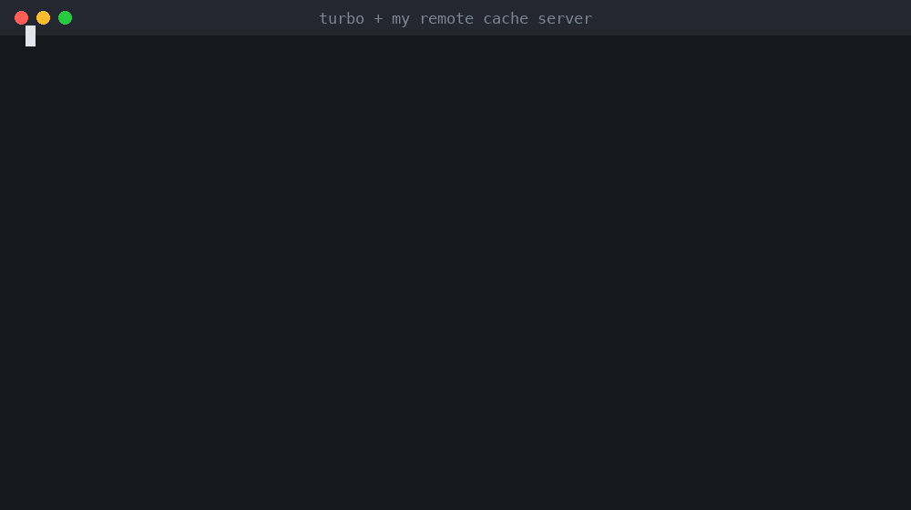
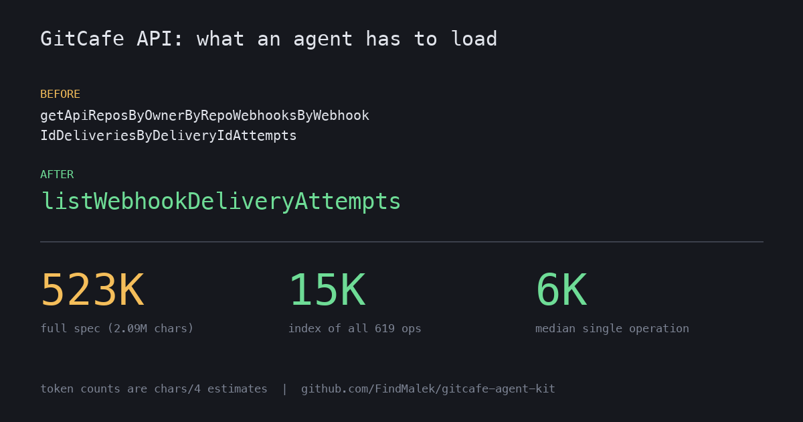

<div align="center">

# gitcafe-agent-kit

**Working fixes for gaps in the public GitCafe surface, built and tested only against public APIs.**

[](#development)
[](LICENSE)
[](#development)



*Real `turbo` 2.11.11 against the cache server in this repo: 2.6 s cold, 11 ms restored from the remote cache.*

</div>

An independent, unofficial project. It uses only what GitCafe publishes: the REST/OpenAPI spec, the `cafe` CLI, MCP, the docs and `llms.txt`. Every claim is in [`FINDINGS.md`](FINDINGS.md), marked **verified**, **documented only** or **not reproduced**, with the exact steps.

## What's inside

| | Problem | Fix | Status |
| --- | --- | --- | --- |
| [`openapi-slicer`](packages/openapi-slicer) | The OpenAPI file is 2.09M characters and its ids look like `getApiReposByOwnerByRepoPullsByPr` | Verb-style ids (`getPullRequest`), per-tag slices, one file per operation, a 59K-char index | Verified against the live spec |
| [`cache`](packages/cache) | `actions/cache` is "Not yet" in GitCafe Actions | A Turborepo-compatible remote cache server (disk or S3/R2) and a drop-in `gitcafe-cache` action | Verified with real `turbo` and a local S3. Not run on a GitCafe runner, see below |
| [`rate-guard`](packages/rate-guard) | All credentials of an account share one budget and success responses don't say what's left | Per-agent sliding-window guard that learns the policy from `RateLimit-Policy` | Verified, 28-request benchmark on a real account |
| [`task-runner`](packages/task-runner) | No documented way to turn an issue into a reviewed stack | Claim issue, git worktree, run your agent, `stack submit --dry-run`, then submit and comment with provenance | Verified end to end on a real private repo |



## Quick start

Needs **Node 24+** (it runs the `.ts` files directly, no build step) and **Bun** for the `cafe` CLI.

```sh
git clone https://git.cafe/findmalek/gitcafe-agent-kit && cd gitcafe-agent-kit
node --test packages/*/test/*.test.ts
```

### Slice the API spec

```sh
node packages/openapi-slicer/src/cli.ts        # fetches the live spec into out/openapi
```

```
out/openapi/INDEX.md            one line per operation, ~15K tokens
out/openapi/ops/listPullRequests.json   one operation plus the schemas it needs
out/openapi/by-tag/pull-requests.json   a whole area
```

Ids are pinned in `packages/openapi-slicer/operation-id.lock.json`, so a spec update can't silently rename the ones you already use. See [`BEFORE_AFTER.md`](packages/openapi-slicer/BEFORE_AFTER.md) for the numbers. Even sliced, `listPullRequests` is about 11K tokens because the response schemas are deep.

### Run a Turborepo remote cache

```sh
CACHE_TOKENS=change-me node packages/cache/src/main.ts

export TURBO_API=http://127.0.0.1:3000 TURBO_TOKEN=change-me TURBO_TEAM=my-team
npx turbo run build
```

| env | meaning |
| --- | --- |
| `CACHE_TOKENS` | comma-separated bearer tokens (required) |
| `CACHE_DIR` | store on disk (default `.cache/turbo`) |
| `S3_BUCKET`, `S3_ENDPOINT`, `S3_REGION`, `S3_ACCESS_KEY_ID`, `S3_SECRET_ACCESS_KEY`, `S3_PREFIX` | store in S3 or R2 instead |
| `PORT`, `HOST` | listen address (default `127.0.0.1:3000`) |

Teams are isolated by `TURBO_TEAM`. `remoteCache.signature` works: artifacts signed with a different key are treated as misses. The Turborepo client calls `/v8/artifacts/...`, which the published spec omits.

### Use the cache in a workflow

GitCafe fetches remote actions from github.com, so reference it there and pin a commit SHA:

```yaml
- uses: FindMalek/gitcafe-agent-kit/packages/cache/action@main
  with:
    path: node_modules
    key: deps-${{ hashFiles('package-lock.json') }}
    restore-keys: deps-
    bucket: ${{ secrets.CACHE_BUCKET }}
    endpoint: https://<account>.r2.cloudflarestorage.com
    access-key-id: ${{ secrets.CACHE_KEY_ID }}
    secret-access-key: ${{ secrets.CACHE_SECRET }}
```

Without credentials it warns and does nothing, so it never breaks a build. Cache entries are trusted: anyone holding the bucket credentials can poison them, so give pull-request jobs a separate `prefix`.

### Guard an agent's API budget

```ts
import { createGuard } from './packages/rate-guard/src/guard.ts';

const guard = createGuard(myTransport, { share: 0.2 }); // this agent may use 20% of the account budget
const reply = await guard.request(req);                 // waits instead of getting a 429
```

It sends one probe request, learns the real quota from `RateLimit-Policy`, then allows at most `share × quota` requests in any window. On a 429 it pauses the whole agent for `Retry-After` and backs off if it repeats. Benchmark: `node packages/rate-guard/bench/bench.ts` (28 requests, about a minute).

### Turn an issue into a stack

```sh
node packages/task-runner/src/cli.ts \
  --repo owner/name --issue 12 --handle me --repo-dir . \
  --agent-name my-agent --model my-model -- ./my-agent.sh
```

It stops after `cafe stack submit --dry-run` unless you add `--submit`. Claiming is best effort: GitCafe has no lease, so the runner assigns the issue, re-reads it and backs off if someone else is also assigned.

## What was and wasn't verified

- **Verified here:** slicer output validates; real `turbo` hits and misses against the server; the cache action's restore, save, prefix fallback and failure modes against a local SigV4-checked S3; the guard on a real account; the task runner on a real private repo.
- **Not verified:** the cache action on a GitCafe runner (hosted runners are limited to admitted organizations), Cloudflare R2 specifically, and a real HTTP 429 (provoking one would breach the acceptable-use policy).
- **Not reproduced:** two claims from earlier research, an MCP/docs contradiction on `commit_changes` and a Link-header/cursor mismatch. [`FINDINGS.md`](FINDINGS.md) says what was checked.

## Development

```sh
node --test packages/*/test/*.test.ts     # 13 tests
packages/cache/e2e/action.sh              # action against a local S3, needs rclone
packages/cache/demo/record.sh             # re-record the demo that the GIF is made from
```

MIT licensed. Not affiliated with GitCafe.
